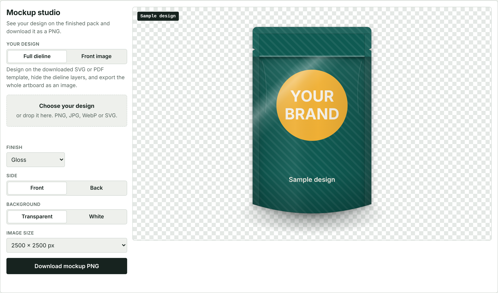

# OpenDieline

**Packaging dielines that are proven to fold, with mockups of your design.**

OpenDieline generates accurate, print-ready box and pouch templates from a size. Before
exporting a box, it folds the blank in 3D and checks that it closes and measures what you
asked for. Then you can put your design on the template and download a mockup.




## Why this exists

A dieline is the flat cut-and-crease plan for a box. A mistake usually shows up after
board has been cut. Free online generators are mostly closed, and most open CAD tools
are not built around packaging.

OpenDieline is a small, dependency-free engine that anyone can build on: designers,
print shops, and packaging apps. It runs in Node.js and in the browser.

## What it does today

| Pack style | ID | Type |
| --- | --- | --- |
| Reverse tuck end | `reverse-tuck-end` | Carton |
| Straight tuck end | `straight-tuck-end` | Carton |
| Sleeve | `sleeve` | Carton |
| Open tray | `tray` | Carton |
| Mailer box | `mailer` | Carton |
| Regular slotted carton | `regular-slotted-carton` | Carton |
| Flat zip pouch | `zip-pouch` | Pouch |
| Stand-up zip pouch | `stand-up-pouch` | Pouch |

- **Fold verification** checks size, wall placement, closure and flap containment.
- **Pouches** include side and top seals, a zipper line, tear notches, an optional hang
  hole, rounded corners, and a bottom gusset on stand-up pouches.
- **Mockup studio** places your artwork on the box or pouch and downloads a PNG with a
  transparent or white background, at up to 4000 × 4000 px.
- **Blank validation** rejects overlaps, broken outlines and panels with no hinge.
- **Board thickness** is built into crease positions.
- **SVG** export has named layers, a bleed guide and real-millimetre sizing.
- **PDF** export is full scale, with `CutContour`, `Crease`, `Seal` and `Zipper` spot colours.
- **DXF** export uses `CUT`, `CREASE`, `SEAL` and `ZIPPER` layers for cutting tables and CAD.
- **Metrics** cover blank size, board area, weight, cut length, and blanks per sheet.
- **Playground** shows an animated fold and has no build or install step for visitors.

## Quick start

Requires Node.js 20 or later. The package is not on npm yet, so build it from source:

```sh
git clone <this repository>
cd opendieline
npm install
npm run build
node dist/cli.js generate reverse-tuck-end -l 80 -w 40 -d 120 -t 0.5 -o out
```

```text
PASS  size: folded 120.50 × 80.50 × 40.50 mm, expected 120.50 × 80.50 × 40.50 mm
PASS  walls: every wall sits on a box face
PASS  closure: 6 of 6 required faces closed
PASS  containment: every flap folds inside the box
Wrote out/reverse-tuck-end.svg
Wrote out/reverse-tuck-end.pdf
Wrote out/reverse-tuck-end.dxf
```

If verification fails, the CLI writes no files and exits with an error.

To open the playground after `npm run build`, open `dist-web/index.html` in a browser.
It is a single file and needs no server.

### Make a mockup

1. Choose a pack style and size, then download the SVG or PDF template.
2. Design on the template, hide the cut and crease layers, and export the whole artboard
   as PNG or JPG.
3. In **Mockup studio**, choose your file. The app matches it to the template page, the
   dieline with bleed, or the dieline alone, and warns you if the shape does not match.
4. Pick a transparent or white background and download the PNG.

**Your own dieline picture.** If your finished dieline is a PNG with a transparent
background and does not match the chosen pack style, the app reads the outline, finds the
four wall panels, the lid and the glue flap, and builds a carton from your picture. The
artwork then lands on each panel exactly where you placed it. A thin sticker outline around
the dieline is ignored. Move the panel lines under the picture if an edge is off.

For a quick preview, choose **Front image** and add one image for the front panel.

Pouch sizes use the same fields as boxes: `--length` is the pouch width, `--depth` is the
height, and `--width` is the bottom gusset.

```sh
node dist/cli.js generate stand-up-pouch -l 140 -w 80 -d 220 --zipper 35 --hang-hole no -o out
```

### Use it as a library

```ts
import { generate, measure, toSvg } from "opendieline";

const { dieline, verification } = generate("mailer", {
  length: 220,
  width: 160,
  depth: 60,
  thickness: 1.5,
});

if (!verification.passed) throw new Error("This blank does not fold correctly.");

const svg = toSvg(dieline, { bleed: 3 });
const { boardArea } = measure(dieline);
```

## How it works

A template only describes panels and which panel folds from which. The compiler derives
everything else, so the cut lines, creases and 3D fold always come from one source:

```text
panels + parents → shared edges become creases, other edges become the cut path
                 → validate the blank → fold in 3D → verify → export
```

Read [the architecture notes](docs/architecture.md), or
[add a box style](docs/adding-a-template.md) in about 30 lines.

## Limitations

This is an early release. Please cut and fold a physical sample before a production run.

- Verification checks geometry. It does not simulate board stiffness, grain or glue.
- Inside sizes add one board thickness at each crease. Printers often use their own
  allowances, especially for corrugated board.
- Panels may share a plane once folded, because each is modelled as a thin sheet.
- Rounded corners are exported as short straight segments.
- Pouch seal patterns, zipper bands and notch shapes vary between converters. Check them
  against your converter's specification.
- Box mockups are geometric renders with simple lighting. Pouch mockups are a front or
  back view with a drawn pillow effect, not a 3D simulation.

## Roadmap

See [ROADMAP.md](ROADMAP.md). Next up are more box styles, artwork placement, and a
hosted service that turns a product description into a checked dieline.

## Contributing

Contributions are welcome, especially new box styles and corrections from people who
work in print and packaging. See [CONTRIBUTING.md](CONTRIBUTING.md).

## License

[Apache License 2.0](LICENSE)
