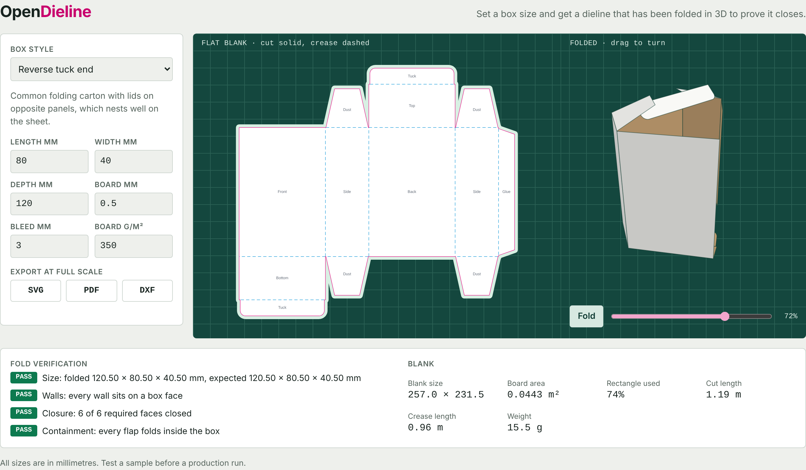

# OpenDieline

**Packaging dielines that are proven to fold.**

OpenDieline generates accurate, print-ready box templates from a size and a board
thickness. Before exporting a dieline, it folds the blank in 3D and checks that the box
closes and measures what you asked for.



## Why this exists

A dieline is the flat cut-and-crease plan for a box. A mistake usually shows up after
board has been cut. Free online generators are mostly closed, and most open CAD tools
are not built around packaging.

OpenDieline is a small, dependency-free engine that anyone can build on: designers,
print shops, and packaging apps. It runs in Node.js and in the browser.

## What it does today

| Box style | ID | Open faces |
| --- | --- | --- |
| Reverse tuck end | `reverse-tuck-end` | 0 |
| Straight tuck end | `straight-tuck-end` | 0 |
| Sleeve | `sleeve` | 2 |
| Open tray | `tray` | 1 |
| Mailer box | `mailer` | 0 |
| Regular slotted carton | `regular-slotted-carton` | 0 |

- **Fold verification** checks size, wall placement, closure and flap containment.
- **Blank validation** rejects overlaps, broken outlines and panels with no hinge.
- **Board thickness** is built into crease positions.
- **SVG** export has named layers, a bleed guide and real-millimetre sizing.
- **PDF** export is full scale, with `CutContour` and `Crease` spot colours.
- **DXF** export uses `CUT` and `CREASE` layers for cutting tables and CAD.
- **Metrics** cover blank size, board area, weight, cut length, and blanks per sheet.
- **Playground** shows an animated fold and has no build or install step for visitors.

## Quick start

Requires Node.js 20 or later. The package is not on npm yet, so build it from source:

```sh
git clone <this repository>
cd opendieline
npm install
npm run build
node dist/cli.js generate reverse-tuck-end -l 80 -w 40 -d 120 -t 0.5 -o out
```

```text
PASS  size: folded 120.50 × 80.50 × 40.50 mm, expected 120.50 × 80.50 × 40.50 mm
PASS  walls: every wall sits on a box face
PASS  closure: 6 of 6 required faces closed
PASS  containment: every flap folds inside the box
Wrote out/reverse-tuck-end.svg
Wrote out/reverse-tuck-end.pdf
Wrote out/reverse-tuck-end.dxf
```

If verification fails, the CLI writes no files and exits with an error.

To open the playground after `npm run build`, open `dist-web/index.html` in a browser.

### Use it as a library

```ts
import { generate, measure, toSvg } from "opendieline";

const { dieline, verification } = generate("mailer", {
  length: 220,
  width: 160,
  depth: 60,
  thickness: 1.5,
});

if (!verification.passed) throw new Error("This blank does not fold correctly.");

const svg = toSvg(dieline, { bleed: 3 });
const { boardArea } = measure(dieline);
```

## How it works

A template only describes panels and which panel folds from which. The compiler derives
everything else, so the cut lines, creases and 3D fold always come from one source:

```text
panels + parents → shared edges become creases, other edges become the cut path
                 → validate the blank → fold in 3D → verify → export
```

Read [the architecture notes](docs/architecture.md), or
[add a box style](docs/adding-a-template.md) in about 30 lines.

## Limitations

This is an early release. Please cut and fold a physical sample before a production run.

- Verification checks geometry. It does not simulate board stiffness, grain or glue.
- Inside sizes add one board thickness at each crease. Printers often use their own
  allowances, especially for corrugated board.
- Panels may share a plane once folded, because each is modelled as a thin sheet.
- Rounded corners are exported as short straight segments.

## Roadmap

See [ROADMAP.md](ROADMAP.md). Next up are more box styles, artwork placement, and a
hosted service that turns a product description into a checked dieline.

## Contributing

Contributions are welcome, especially new box styles and corrections from people who
work in print and packaging. See [CONTRIBUTING.md](CONTRIBUTING.md).

## License

[Apache License 2.0](LICENSE)
